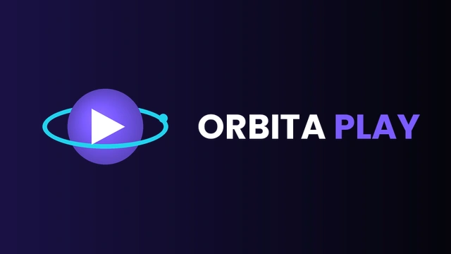

<div align="center">
  
  <h1>Orbita Play</h1>
  <p><strong>Canais, filmes, séries e futebol — na TV, no celular e no tablet.</strong></p>
</div>

Orbita Play é uma versão personalizada do [ARVIO](https://github.com/ProdigyV21/ARVIO)
(Apache 2.0), com marca própria e o menu principal reorganizado. Os add-ons, a TV ao vivo,
o player e todo o resto do ARVIO continuam funcionando como no original.

## Menu

| Ordem | Item | O que abre |
| --- | --- | --- |
| 1 | **Canais** | TV ao vivo (listas IPTV / M3U configuradas) |
| 2 | **Filmes** | Catálogo inicial mostrando só filmes |
| 3 | **Séries** | Catálogo inicial mostrando só séries |
| 4 | **Futebol** | TV ao vivo já aberta no grupo de futebol/esportes da sua lista |
| 5 | Buscar | Busca |
| 6 | Biblioteca | Minha lista / calendário |
| ⚙ | Ajustes | Configurações, add-ons, IPTV |

O item **Futebol** procura, nesta ordem: um grupo com "futebol", "football", "premiere",
"brasileirão"… no nome; depois um grupo de "esporte/sport/espn"; por último a categoria
"Esportes" que o próprio app monta.

## Baixar o APK

Cada envio para a branch `main` gera um APK automaticamente:
**Actions → Build Orbita Play APK → (última execução) → Artifacts → OrbitaPlay-SideloadDebug**.
Para um APK otimizado, rode o workflow manualmente escolhendo `SideloadRelease`.

## Compilar no computador

Requisitos: Android Studio (JDK 17, Android SDK 36).

```bash
cp secrets.defaults.properties secrets.properties
./gradlew assembleSideloadDebug
```

O APK fica em `app/build/outputs/apk/sideload/debug/`.

## O que mudou em relação ao ARVIO

- Nome **Orbita Play**, ícone, banner da Android TV e logos novos.
- `applicationId` = `com.orbitaplay.tv` (instala ao lado do ARVIO, sem conflito).
- Menu: Canais, Filmes, Séries, Futebol primeiro (TV e celular).
- Atualizador interno aponta para `caslu1/Orbita-Play`.
- Relatórios de falha (Crashlytics) desligados — o projeto Firebase incluído é do ARVIO.
- Workflows de deploy do site/servidores do ARVIO removidos.

Pontos principais no código:
`ui/components/Sidebar.kt` (menu e `OrbitaNav`), `ui/screens/home/OrbitaHomeSection.kt`
(Filmes/Séries), `ui/screens/tv/live/OrbitaFootball.kt` (Futebol),
`navigation/AppNavigation.kt` (rotas `series` e `football`), `ui/components/AppBottomBar.kt`
(menu do celular).

## Licença

Baseado no ARVIO © seus autores, licenciado sob Apache License 2.0 — veja [LICENSE](LICENSE).
README original do ARVIO: [docs/ARVIO-README.md](docs/ARVIO-README.md).
O app não inclui filmes, séries ou canais; use apenas fontes que você tem direito de acessar.
